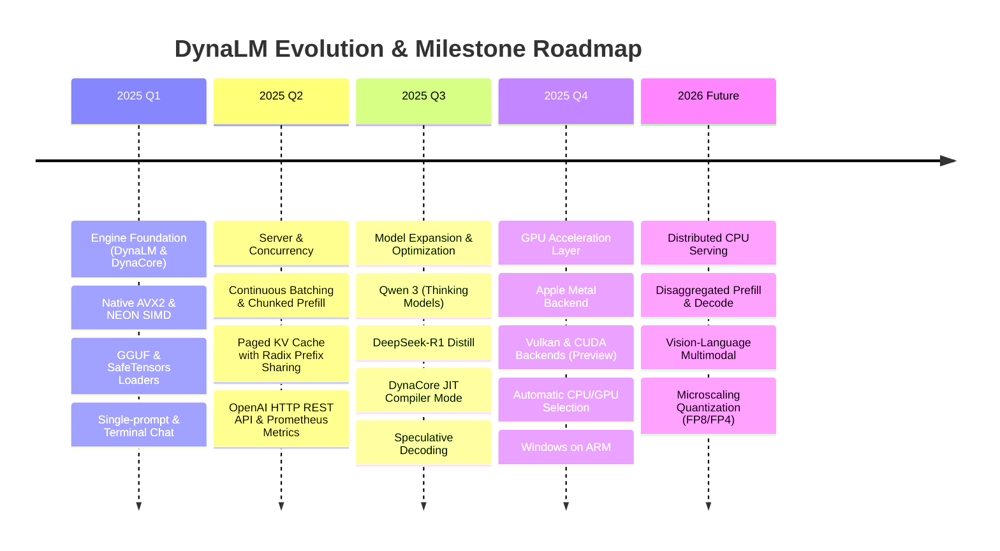

# DynaLM Project Roadmap & Engineering Milestones

> This document outlines the technical development roadmap, upcoming milestones, and architectural direction for **DynaLM** — the high-performance, private, local LLM CPU inference engine and OpenAI-compatible server.

---

## 🎯 Vision & Core Principles

1. **CPU-First Excellence:** Deliver class-leading token generation throughput and latency on consumer laptops, desktop CPUs, and edge hardware without requiring dedicated GPUs.
2. **Zero-Friction Ergonomics:** Single statically linked native binary (C++20), zero Python/CUDA dependencies, with familiar Ollama-compatible CLI workflows (`pull`, `run`, `serve`).
3. **Drop-in Standards:** First-class OpenAI-compatible REST API (`/v1/chat/completions`) with Server-Sent Events (SSE) streaming for immediate integration with LangChain, LlamaIndex, LiteLLM, Open WebUI, and Cursor.
4. **Air-Gapped Privacy:** Zero telemetry, no phoning home, no cloud accounts, and 100% offline local inference.

---

## 🧭 Milestone Timeline

---

## 📍 Feature Status & Upcoming Capabilities

### 1. Hardware Backends & Acceleration

| Capability | Status | Target Hardware / Platform | Details & Notes |
| :--- | :---: | :--- | :--- |
| **x86_64 AVX2 SIMD** | ✅ Shipped | x86-64 (Intel, AMD) | Native vectorized kernels, zero-copy `mmap`. |
| **ARM64 NEON SIMD** | ✅ Shipped | Apple Silicon, ARM64 Linux | Hand-tuned NEON vector routines for ARM v8/v9. |
| **Compiled Kernel Mode** | ✅ Shipped | x86_64 & ARM64 | DynaCore IR JIT compiling and kernel fusion. |
| **Intel AMX / AVX-512** | 🔄 In Progress | Intel CPUs with AVX-512 / AMX | Matrix Tile acceleration for high-throughput prefill. |
| **Apple Metal GPU Backend** | 🧪 Preview | macOS on Apple Silicon | Whole-step GPU graphs, in-place paged attention, zero-copy weights ([docs/gpu.md](docs/gpu.md)). |
| **Vulkan GPU Backend** | 🧪 Preview | AMD, Intel, NVIDIA and Qualcomm GPUs | Same engine features as Metal: continuous batching, paged KV, prefix sharing. |
| **NVIDIA CUDA Backend** | 🧪 Preview | NVIDIA GPUs | Built on the same GPU device layer ([docs/gpu.md](docs/gpu.md)). |
| **Automatic CPU/GPU Selection** | ✅ Shipped | All platforms | `--backend auto` picks the GPU when it can run the model, else the CPU. |
| **Windows on ARM** | 🧪 Preview | Windows 11 ARM64 | Native ARM64 build with NEON kernels. |
| **GPU: Qwen3 / Gemma 3 / Llama 3.x / MoE** | 📋 Planned | All GPU backends | Per-head Q/K norm, Llama 3 / YaRN RoPE scaling and expert routing on the GPU. |
| **GPU multi-user throughput** | 🔄 In Progress | All GPU backends | Larger batched prefill to raise total tokens/s with 8+ users. |

---

### 2. Supported Model Architectures

| Architecture | Status | Supported Sizes & Variants |
| :--- | :---: | :--- |
| **Meta Llama** | ✅ Shipped | Llama 1, 2, 3, 3.1, 3.2 (1B, 3B, 8B, 70B) |
| **Qwen (Dense & MoE)** | ✅ Shipped | Qwen 2, Qwen 2.5, Qwen 3 (0.5B, 1.5B, 4B, 7B, 14B) |
| **DeepSeek R1 Distill** | ✅ Shipped | DeepSeek-R1-Distill-Qwen (1.5B, 7B, 8B, 14B), DeepSeek-R1-Distill-Llama |
| **Google Gemma** | ✅ Shipped | Gemma 1, Gemma 2, Gemma 3 (270M, 1B, 2B, 9B, 27B) |
| **Microsoft Phi** | ✅ Shipped | Phi-3 Mini, Phi-3.5 Medium |
| **Mistral AI** | ✅ Shipped | Mistral 7B, Mixtral 8x7B MoE |
| **IBM Granite** | ✅ Shipped | Granite 3.x, Granite-MoE |
| **Qwen 3.5 / 3.8** | 📋 Planned | Next-generation hybrid architectures |
| **DeepSeek-V3 / R1 (Full 671B MoE)** | 📋 Planned | CPU offloading with sparse activation & disk streaming |
| **Multimodal / Vision-Language (VLM)** | 📋 Planned | Llama 3.2 Vision, Qwen2-VL, Gemma-Vision |

---

### 3. Model Formats & Quantization

| Format / DType | Status | Description |
| :--- | :---: | :--- |
| **GGUF Format** | ✅ Shipped | Direct zero-copy memory mapping for all llama.cpp `.gguf` files |
| **SafeTensors** | ✅ Shipped | Direct native loading of Hugging Face `.safetensors` model directories |
| **GPTQ & AWQ** | ✅ Shipped | On-the-fly repacking for 4-bit weights |
| **Standard Quantization** | ✅ Shipped | `Q4_K_M` (Recommended), `Q2_K`–`Q8_0`, `F16`, `BF16`, `F32` |
| **Q8_0 Paged KV Cache** | ✅ Shipped | Cuts KV cache RAM footprint by 50% during long context serving |
| **Legacy IQ Types** | 📋 Planned | `IQ2_XXS`, `IQ3_S`, `IQ4_NL` quantization variants |
| **FP8 / FP4 Microscaling** | 📋 Planned | Emerging low-bit floating point matrix formats |

---

### 4. Serving Engine & API Features

- [x] **Continuous Batching:** Dynamic request injection during token generation phases.
- [x] **Paged KV Cache:** Refcounted block pool with copy-on-write page allocation.
- [x] **Chunked Prefill:** Interleaves prompt evaluation with token decoding to minimize latency spikes.
- [x] **Prefix (Radix) Caching:** Shared KV blocks for common system prompts and chat histories.
- [x] **Speculative Decoding:** Small draft model acceleration to boost single-stream token generation.
- [x] **Prometheus Metrics:** Native `/metrics` endpoint measuring TTFT, throughput, and RSS memory.
- [ ] **Structured JSON Outputs (Grammar Masking):** Enforce strict JSON schema validation during sampling.
- [ ] **Function / Tool Calling API:** Native support for tool calls in `/v1/chat/completions`.
- [ ] **Distributed Disaggregated Serving:** Separate prefill nodes and decode nodes across a local network.

---

## 🤝 How to Influence the Roadmap

Community input directly shapes DynaLM's priorities:
- Propose feature requests or report architectural enhancements via [GitHub Issues](https://github.com/dynalm-project/dynalm/issues).
- Check the [documentation](README.md#documentation) and [CLI reference](docs/cli.md) for current features.
- Review [CONTRIBUTING.md](CONTRIBUTING.md) to submit pull requests.
