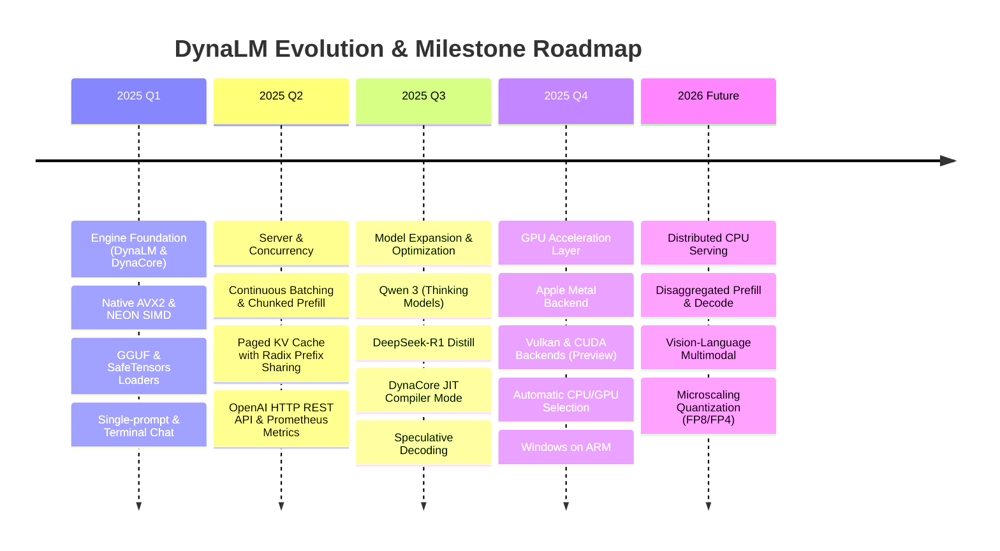

# DynaLM Project Roadmap & Engineering Milestones

> This document outlines the technical development roadmap, upcoming milestones, and architectural direction for **DynaLM** — the high-performance, private, local LLM CPU inference engine and OpenAI-compatible server.

---

## 🎯 Vision & Core Principles

1. **CPU-First Excellence:** Fast, accurate token generation on consumer laptops, desktop CPUs, and edge hardware without requiring dedicated GPUs. Measured results, including where llama.cpp is ahead, are in the README's [Speed](README.md#speed) section.
2. **Zero-Friction Ergonomics:** Single statically linked native binary (C++20), zero Python/CUDA dependencies, with familiar Ollama-compatible CLI workflows (`pull`, `run`, `serve`).
3. **Drop-in Standards:** OpenAI-compatible REST API (`/v1/chat/completions`, `/v1/completions`, `/v1/models`) with Server-Sent Events (SSE) streaming, designed for tools such as LangChain, LlamaIndex, LiteLLM, Open WebUI and Cursor (for this beta only DynaLM's own client and test suite are verified against it).
4. **Air-Gapped Privacy:** Zero telemetry, no phoning home, no cloud accounts, and 100% offline local inference.

---

## 🧭 Milestone Timeline

---

## 📍 Feature Status & Upcoming Capabilities

**Status labels** (this beta; the same as the README's):
- ✅ **Beta-verified:** checked for this release on real hardware with real models (Apple M4 Pro, macOS 26):
  the full test suite plus token-by-token parity with llama.cpp.
- ☑️ **CI-tested:** built, tested with the model-free test suite and checked with a fresh install in CI
  on that platform; not yet checked with real models for this release.
- 🧪 **Preview:** implemented and covered by DynaLM's model-free tests, not yet checked with real models
  for this release.
- ⚗️ **Experimental:** built in CI, tested only on a software GPU or not on a GPU at all.
- 🔄 **In progress** · 📋 **Planned**

### 1. Hardware Backends & Acceleration

| Capability | Status | Target Hardware / Platform | Details & Notes |
| :--- | :---: | :--- | :--- |
| **CPU on Apple Silicon (ggml kernels, NEON)** | ✅ Beta-verified | macOS on Apple Silicon | The default CPU path (`--cpu`); parity with llama.cpp 99.96–100% on eight models. |
| **CPU on x86-64 (AVX2) and Linux ARM64** | ☑️ CI-tested | x86-64 (Intel, AMD), ARM64 Linux | Built and tested in CI (model-free tests); not checked with real models for this release. |
| **Exact mode (`--mode exact`, DynaCore's CPU kernels)** | 🧪 Preview | x86-64, ARM64 | DD-053 accuracy reference path; slower than the default CPU path. |
| **Compiled Kernel Mode** | 🧪 Preview | x86_64 & ARM64 | DynaCore IR compiling and kernel fusion (`--execution compiled`; the GPU always uses it). |
| **Intel AMX / AVX-512** | 🔄 In Progress | Intel CPUs with AVX-512 / AMX | Matrix Tile acceleration for high-throughput prefill. |
| **Apple Metal GPU Backend** | ✅ Beta-verified | macOS on Apple Silicon (M4 Pro tested) | Whole-step GPU graphs, in-place paged attention, zero-copy weights; parity 99.80–100% on eight models ([docs/gpu.md](docs/gpu.md)). |
| **Vulkan GPU Backend** | ⚗️ Experimental | AMD, Intel, NVIDIA and Qualcomm GPUs | Built in CI and tested on a software GPU (lavapipe) only. |
| **NVIDIA CUDA Backend** | ⚗️ Experimental | NVIDIA GPUs | Built in CI; not tested on a GPU. |
| **Automatic CPU/GPU Selection** | ✅ Beta-verified (macOS) · 🧪 elsewhere | All platforms | `--backend auto` picks the GPU when it can run the model, else the CPU. |
| **Windows (x64, ARM64)** | ☑️ CI-tested | Windows 10/11 | Built and tested in CI (model-free tests). |
| **GPU: Qwen3 / Gemma 3 / MoE** | ✅ Beta-verified on Metal | Metal | Qwen3 0.6B/4B/8B, Gemma 3 1B and Granite 3.1 MoE pass parity on Metal; YaRN RoPE scaling still runs on the CPU; MoE on CUDA is not supported yet. |
| **GPU multi-user throughput** | 🔄 In Progress | All GPU backends | At 16 users DynaLM delivers 0.71–0.78× llama.cpp's total tokens/s on Metal (README [Speed](README.md#speed)). |

---

### 2. Supported Model Architectures

| Architecture | Status | Supported Sizes & Variants |
| :--- | :---: | :--- |
| **Meta Llama** | ✅ Beta-verified: Llama 3.1 8B Instruct (Q8_0) · 🧪 Preview: other Llama 1–3.2 versions and sizes | Llama 1, 2, 3, 3.1, 3.2 |
| **Qwen (Dense & MoE)** | ✅ Beta-verified: Qwen2.5 0.5B / 1.5B Instruct (Q4_K_M), Qwen3 0.6B (Q8_0), 4B / 8B (Q4_K_M) · 🧪 Preview: other sizes, MoE | Qwen 2, Qwen 2.5, Qwen 3 |
| **DeepSeek R1 Distill** | 🧪 Preview | DeepSeek-R1-Distill-Qwen, DeepSeek-R1-Distill-Llama |
| **Google Gemma** | ✅ Beta-verified: Gemma 3 1B (Q4_K_M) · 🧪 Preview: Gemma 1, 2 and other Gemma 3 sizes | Gemma 1, Gemma 2, Gemma 3 |
| **Microsoft Phi** | 🧪 Preview | Phi-3 Mini, Phi-3.5 Medium |
| **Mistral AI** | 🧪 Preview | Mistral 7B, Mixtral 8x7B MoE |
| **IBM Granite** | ✅ Beta-verified: Granite 3.1 1B-A400M (MoE, Q4_K_M) · 🧪 Preview: other Granite 3.x | Granite 3.x, Granite-MoE |

"Beta-verified" models were checked token by token against llama.cpp on the CPU and on Metal
(parity 99.80–100%), with DD-053 GPU accuracy and greedy-text checks. Preview models load and run
with the same code but were not checked for this release.
| **Qwen 3.5 / 3.8** | 📋 Planned | Next-generation hybrid architectures |
| **DeepSeek-V3 / R1 (Full 671B MoE)** | 📋 Planned | CPU offloading with sparse activation & disk streaming |
| **Multimodal / Vision-Language (VLM)** | 📋 Planned | Llama 3.2 Vision, Qwen2-VL, Gemma-Vision |

---

### 3. Model Formats & Quantization

| Format / DType | Status | Description |
| :--- | :---: | :--- |
| **GGUF Format** | ✅ Beta-verified | Zero-copy memory mapping of llama.cpp `.gguf` files (verified: Q4_K_M and Q8_0 on the models above) |
| **SafeTensors** | 🧪 Preview | Native loading of Hugging Face `.safetensors` model directories |
| **GPTQ & AWQ** | 🧪 Preview | On-the-fly repacking for 4-bit weights |
| **Other quantizations** | 🧪 Preview | `Q2_K`–`Q6_K`, `F16`, `BF16`, `F32` (kernel tests; not checked with real models for this release) |
| **Q8_0 Paged KV Cache** | 🧪 Preview | Halves KV cache memory (`--kv q8_0`); not checked for accuracy in this release |
| **Legacy IQ Types** | 📋 Planned | `IQ2_XXS`, `IQ3_S`, `IQ4_NL` quantization variants |
| **FP8 / FP4 Microscaling** | 📋 Planned | Emerging low-bit floating point matrix formats |

---

### 4. Serving Engine & API Features

Implemented and covered by DynaLM's test suite (continuous batching, isolation, prefix-cache
equivalence, cancellation, overload, streaming); multi-user speed and latency are measured in the
README's [Speed](README.md#speed) section.

- [x] **Continuous Batching:** Dynamic request injection during token generation phases.
- [x] **Paged KV Cache:** Refcounted block pool with copy-on-write page allocation.
- [x] **Chunked Prefill:** Interleaves prompt evaluation with token decoding to minimize latency spikes.
- [x] **Prefix (Radix) Caching:** Shared KV blocks for common system prompts and chat histories.
- [x] **Speculative Decoding:** Small draft model acceleration to boost single-stream token generation.
- [x] **Prometheus Metrics:** Native `/metrics` endpoint measuring TTFT, throughput, and RSS memory.
- [ ] **Structured JSON Outputs (Grammar Masking):** Enforce strict JSON schema validation during sampling.
- [ ] **Function / Tool Calling API:** Native support for tool calls in `/v1/chat/completions`.
- [ ] **Distributed Disaggregated Serving:** Separate prefill nodes and decode nodes across a local network.

---

## ⚠️ Known Limitations (this beta)

- **Platforms:** beta-verified on macOS on Apple Silicon only (one machine, M4 Pro). Linux and Windows
  are CI-tested; Vulkan and CUDA are Experimental.
- **Multi-user GPU throughput:** at 16 users DynaLM delivers 0.71–0.78× llama.cpp's total tokens/s
  (confirmed on 3 of 4 models; its worst-case token gaps are much shorter, confirmed on the 8B models).
- **Four-user tail latency:** with 4 users the 99th-percentile gap between tokens is longer than
  llama.cpp's (0.19–0.30×, consistent but not confirmed by the verdict rule), because new prompts are
  processed in chunks alongside running streams.
- **CPU decode:** 0.77–0.97× llama.cpp's time per token, more at longer contexts (the two engines'
  CPU builds differ: llama.cpp native with Apple Accelerate, DynaLM portable).
- **Memory limits:** DynaLM refuses a KV cache that does not fit the GPU working set instead of
  failing mid-run. Example: Llama-3.1-8B Q8_0 with 16 users × 4,096 tokens (65,536 tokens) on a
  24 GB Mac is refused at load (8.0 GiB of KV against 6.9 GiB available); it runs with
  `--ctx 57024` or less, or with `--kv q8_0`.
- **Long-running Metal servers:** the automatic sparse attention that keeps a cache-filled KV pool
  fast covers contexts up to 4,096 tokens; longer contexts still slow down as the cache fills.

---

## 🤝 How to Influence the Roadmap

Community input directly shapes DynaLM's priorities:
- Propose feature requests or report architectural enhancements via [GitHub Issues](https://github.com/dynalm-project/dynalm/issues).
- Check the [documentation](README.md#documentation) and [CLI reference](docs/cli.md) for current features.
- Review [CONTRIBUTING.md](CONTRIBUTING.md) to submit pull requests.
